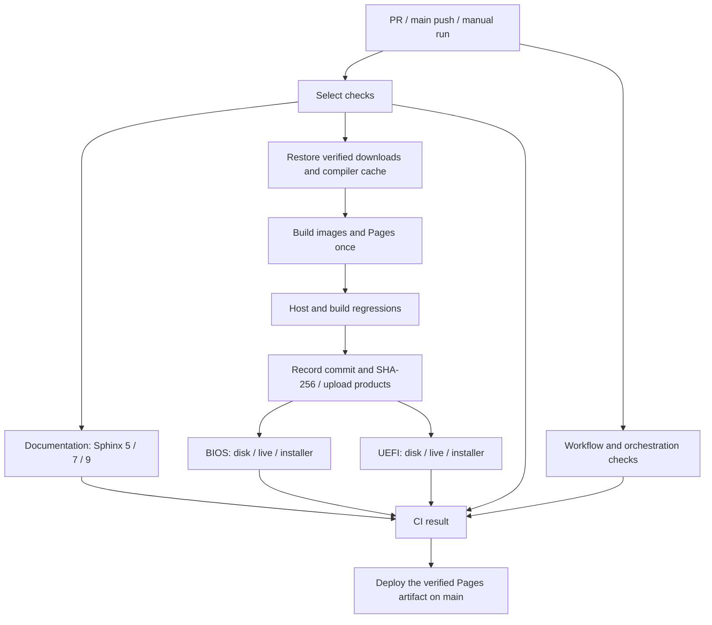

# ReliefOS automation



`ci.yml` owns validation and Pages deployment. `check-docs.yml` is a reusable
workflow; it no longer runs separately on branch pushes and PR updates.
SourceHut mirroring and manual code statistics remain independent maintenance
workflows. Job dependencies form the native graph on the Actions run page.

## Selection and the merge check

PRs changing only manuals run documentation checks without compiling images.
README, PR template and maintenance workflow changes still run workflow checks.
Unknown source paths require a full build. Shared build/version/kernel inputs
also run the documentation compatibility matrix. Main pushes and manual runs
always run all stages. Select **CI result** as the required branch check: it
fails for failed, cancelled, missing or unexpectedly skipped required jobs.

`tools/ci.py changes` uses the actual PR base and checked-out merge commit,
including removed and renamed files. It does not depend on the Actions paths
filter's file-count limit. Manual runs default to validation only. Checking
`deploy_pages` explicitly enables publication and is accepted only on `main`.

## Products, signatures and deployment

The build job runs `make all pages` and `make test` in one working tree. This
lets product-dependent regressions consume the current SDK, libraries and
staging tree without transferring the entire compiler output between jobs.
Common runner dependencies live in `scripts/ci/install.sh` and the local setup
action. The build checkout includes full Git history for kernel rollback
regressions. Host development packages include FFmpeg, Cairo, GLib and Xvfb.

Builds start alongside workflow checks and the documentation matrix; the final
gate still requires all selected stages. `make -j"$(nproc)" test` passes the
jobserver through the contract runner to nested Make processes. Suites remain
sequential because some temporarily probe shared source files. Each suite logs
its elapsed seconds, and a dry run never executes its scripts.

The download cache covers both repositories' `cache/downloads`, keyed by both
dependency locks and runner platform. A fallback can supply unchanged archives
after a lock update, but `make fetch` still verifies their hashes and replaces
stale bytes before a build. Verified downloads are saved before compilation,
so a later test failure does not throw them away. ReliefNT fetch is already
delegated by the parent and is not repeated.

`ccache` wraps the standard compiler names for the build and its nested tests.
Its cache is limited to 1 GiB, checks compiler contents, and retains the default
header, flag and working-directory checks. Path rewriting stays disabled so
Kbuild source/dependency records retain their native paths. Each run saves a new cache, even
after a test failure, and reports hits/misses in the run summary. No output
tree, signed APK, image or private key is restored from a build cache. GitHub's
cache ref scope separates PR caches from the default branch. The pinned
actionlint binary has a separate platform/version cache; warm runs avoid
installing Go just to rebuild the linter.

Publishing builds use `RELIEFOS_APK_SIGNING_KEY_B64`, with the existing
legacy secret fallback. PRs and validation-only manual runs use
an ephemeral RSA key. APKs, images, the installer download and RPR share one
build and signing cohort. The private key stays in the runner's temporary
directory and is removed before artifact upload, including on failure.

`ci/manifest.json` records the source commit, kernel release, sizes and SHA-256
of all three boot media, `.config` and `kernel-install/install.bundle.json`.
The exact same installer must appear in Pages. The public Pages tree contains
the manifest as `build-manifest.json`. Boot jobs verify all five files both
before and after running; they call the existing acceptance runner directly
and never invoke Make or rebuild an image.

BIOS and UEFI each test disk, live ISO and installer ISO. The runner requires
kernel/PID 1 evidence and the expected graphical login or installer screen,
checks the recorded kernel release, and uses private scratch disks. KVM is
used when accessible, otherwise TCG. Boot logs, screenshots and result records
are retained for seven days; images and Pages artifacts for three days.

Only a successful `CI result` allows the deployment job to consume this run's
Pages artifact. Pages permissions and the `github-pages` environment belong
only to that job. A running main build is allowed to finish; GitHub keeps the
newest pending run in the concurrency group. Newer PR updates cancel
superseded PR runs. GitHub Release publication remains a separate procedure.

## Local validation

```sh
actionlint
shellcheck scripts/ci/*.sh
sh tests/build/test-ci.sh
```

The workflow pins third-party action commits and actionlint's version. Full
product verification uses the existing `make test` and dual-firmware boot
acceptance, rather than treating YAML validation as runtime evidence.
