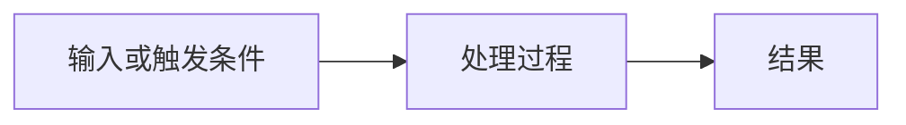

## 问题与效果

<!-- 写明触发问题的场景，以及修改后的行为。关联 issue 时使用 Fixes #编号。 -->

## 流程与实现

<!-- 描述关键改动。涉及跨组件、构建、安装或发布流程时，可以加入 Mermaid：

简单改动可删除本节。 -->

## 验证

<!-- 列出实际执行的命令、结果和必要的运行证据；说明未完成的验证及原因。
CI result 汇总本次要求的检查；构建清单记录提交号、内核版本和产物校验值。 -->

## 兼容性与发布影响

<!-- 涉及 ABI、配置、APK/RPR、子模块或升级行为时说明影响；无此类影响可删除本节。 -->
